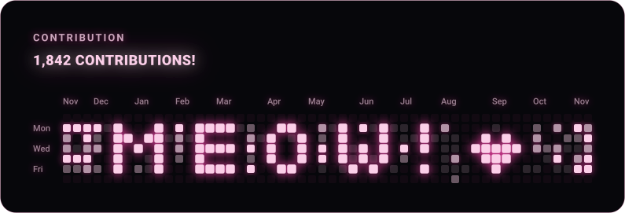

# GitHub Contributions (MEOW edition)

A React + TypeScript project that fetches your real GitHub contribution calendar, renders it with the MEOW design, and writes a standalone `public/github-contributions.svg` that a GitHub Action refreshes daily.

The graph is one SVG-native React component (`src/components/Contributions.tsx`). Vite renders it in the browser and `react-dom/server` renders it to the SVG file, so the two can't drift apart.

```
src/components/Contributions.tsx   the design (SVG-native; MEOW_PIXELS lives here)
src/lib/contributions.ts           data shaping, intensity levels, month labels, mock data
scripts/fetch-contributions.ts     GitHub GraphQL -> public/contributions.json
scripts/generate-svg.tsx           component -> public/github-contributions.svg
.github/workflows/update-contributions.yml
```

## 1. Install

Requires Node 20.12+ (22 recommended).

```bash
npm install
```

## 2. Run locally (no token needed)

```bash
npm run dev
```

Opens the Vite preview with **mock data**. Once you've run `npm run fetch` (step 4), it shows your real data instead.

Generate an SVG from mock data any time:

```bash
npm run generate:mock
```

## 3. Create a GitHub token

1. GitHub → **Settings → Developer settings → Personal access tokens → Tokens (classic) → Generate new token (classic)**.
2. Name it e.g. `contributions-svg`, and tick only the **`read:user`** scope.
3. Copy the token (you won't see it again).

To include private-repo activity in the count, turn on **"Private contributions"** in your profile's *Contribution settings* (the dropdown above your contribution graph on github.com).

## 4. Fetch real data and generate the SVG manually

```bash
cp .env.example .env     # then edit .env: GH_TOKEN and GH_USERNAME
npm run update           # = npm run fetch && npm run generate
```

`.env` is git-ignored. The token is only read by the Node scripts and never reaches the browser bundle.

Individual steps: `npm run fetch` (writes `public/contributions.json`) and `npm run generate` (writes `public/github-contributions.svg`).

## 5. Configure GitHub Actions

1. Push this project to a **public** GitHub repo (e.g. `github-contributions`, or your profile repo `<username>/<username>`).
2. Repo → **Settings → Secrets and variables → Actions → New repository secret**
   - Name: `GH_CONTRIBUTIONS_TOKEN`
   - Secret: the token from step 3
3. Repo → **Settings → Actions → General → Workflow permissions** → choose **Read and write permissions** → Save.
4. Go to the **Actions** tab → **Update contributions SVG** → **Run workflow** to test it.

After that it runs daily at 03:17 UTC. It commits only when the SVG actually changed, so quiet days produce no commit.

- The username defaults to the repo owner. For an org-owned repo, add a repository *variable* `GH_USERNAME` under Settings → Secrets and variables → Actions → Variables.
- GitHub can pause scheduled workflows on repos with no activity for 60 days. If that happens, click **Enable workflow** in the Actions tab.

## 6. Show it on your profile README

Your profile README lives in the repo named exactly like your username (`<username>/<username>`).

**If this project is a separate repo** (simplest and recommended):

```md

```

**If you put this project inside your profile repo itself:**

```md

```

Use your real default branch name instead of `main` if it differs. GitHub caches README images, so changes can take a little while to appear.

## How the data maps to the design

- **Window:** the newest 52 week-columns of the GitHub contribution calendar. Row 0 = Sunday, which matches the Mon/Wed/Fri labels.
- **Total:** sum of the days actually shown (can differ slightly from the number on your profile, which covers a full year including a partial week).
- **Intensity:** days with 0 contributions are the dim base cell. Active days are split into four levels by quartile (GitHub's approach), mapped onto your original brightness and glow tiers.
- **MEOW + heart:** a permanent overlay, drawn above the data. Neighbouring cells are dimmed with your original "weight × 0.3" rule.
- **Month labels:** placed above the week where each month begins (labels that would collide are dropped).
